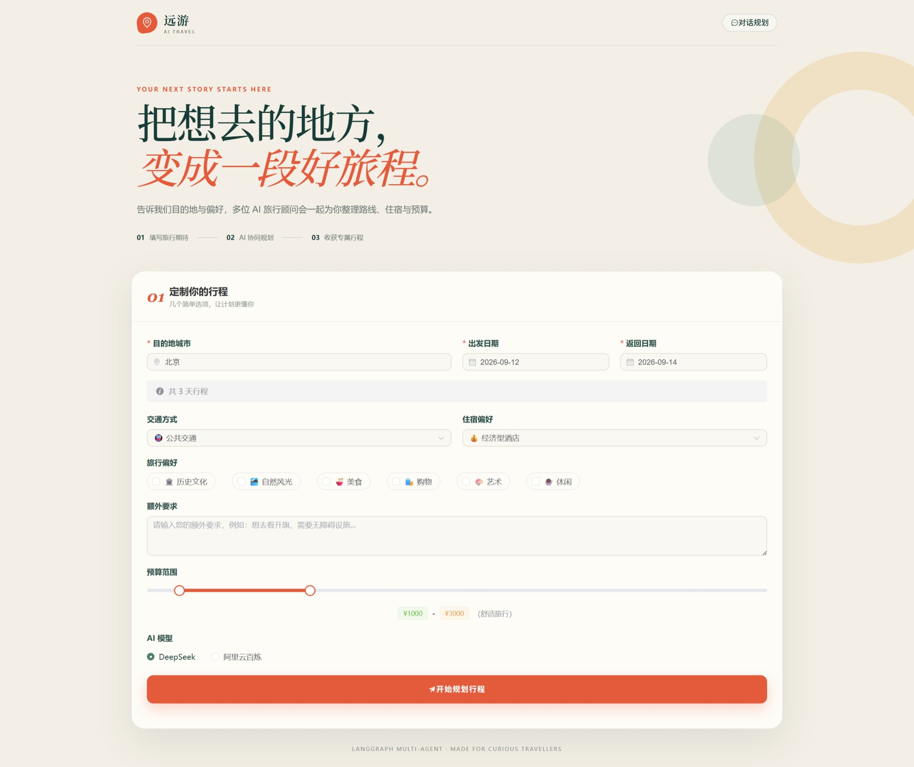
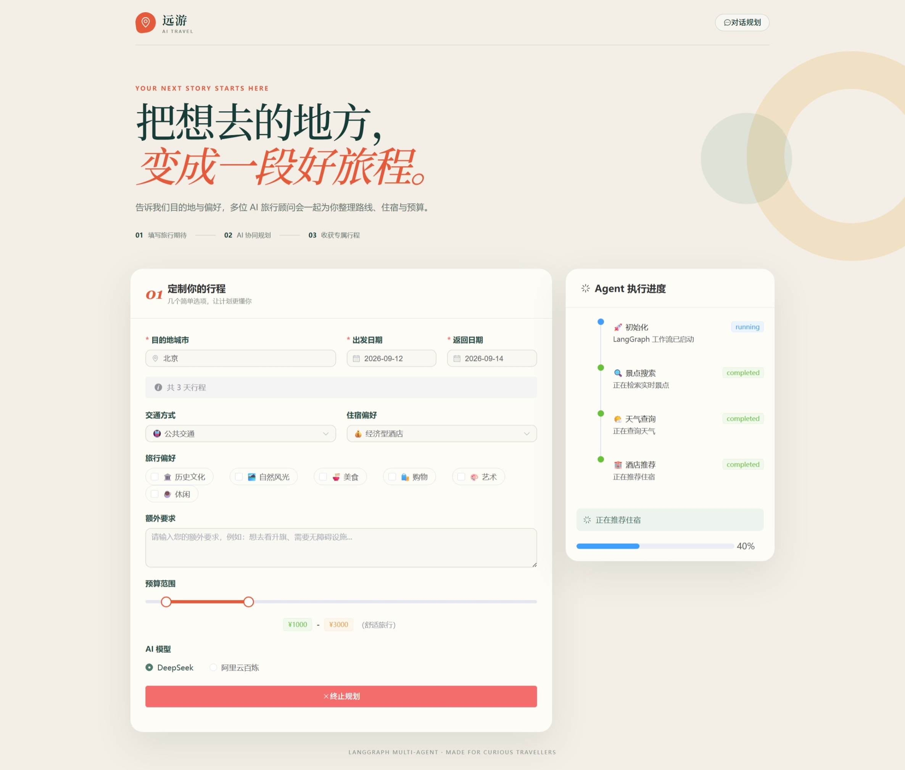
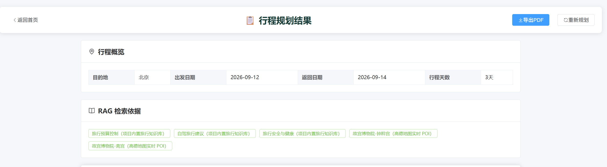
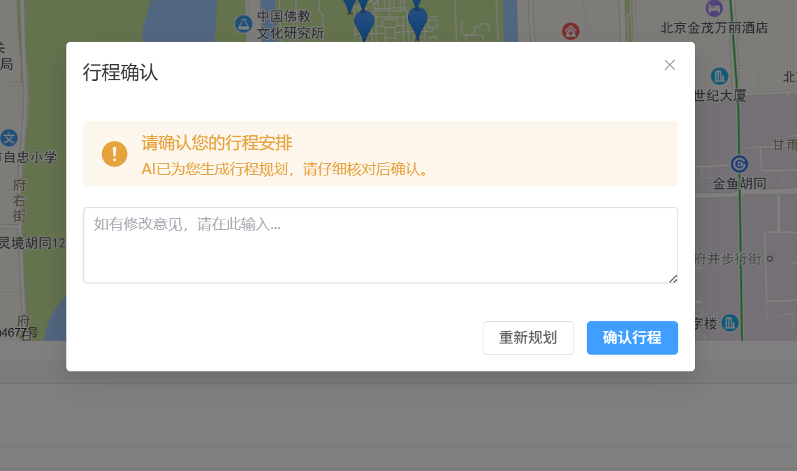
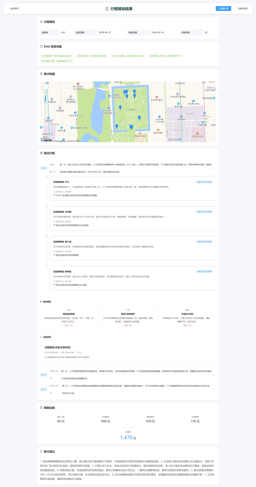

# 远游（YuanYou）- 基于 LangGraph、RAG 的智能旅行规划助手

远游是一个面向 Agent 工程实践的智能旅行规划系统。系统同时提供自然语言对话和结构化表单两种入口，能够完成需求补全、实时旅行信息查询、知识库检索、行程生成、约束校验、人工确认、历史恢复与第三方平台预订交接。

项目当前版本已经不再是固定顺序调用接口的普通工作流，而是由 LLM Supervisor 先根据任务生成工具组合与执行顺序，再由 LangGraph 按状态循环执行、检查冲突并决定是否进入修复节点。

> 项目版本：`2.0.0`  
> 后端：FastAPI + LangGraph 1.x  
> 前端：Vue 3 + TypeScript + Element Plus  
> 当前开发端口：前端 `5173`，后端 `18080`

## 项目亮点

| 能力 | 当前实现 |
| --- | --- |
| 自由文本对话 | LLM 意图识别、槽位抽取、多轮追问和规则降级 |
| Agent 决策 | Supervisor 一次生成工具计划，动态选择 POI、天气、酒店与 RAG 工具 |
| 自主修复 | 自动发现预算超限、单日过载和跨日重复景点，最多修复两轮 |
| RAG ETL | PDF、DOCX、TXT、Markdown 解析；扫描 PDF 自动 OCR；清洗、分块、Embedding、Chroma 入库 |
| 混合检索 | 向量检索与轻量 BM25 并行召回，使用 RRF 融合排序 |
| 长期记忆 | SQLite 保存偏好和聊天，Chroma 按语义召回当前用户的相关偏好 |
| 历史行程 | 每次成功生成的完整 `plan_json` 独立保存，可查看、恢复和删除 |
| 状态持久化 | `AsyncSqliteSaver` 保存 LangGraph Checkpoint，服务重启后仍可恢复 |
| 实时旅行数据 | 高德地图 POI、天气、住宿搜索，多个 POI 请求并行执行 |
| 人工审核 | 行程草稿生成后暂停，用户批准或拒绝后恢复工作流 |
| 交易闭环演示 | 第三方平台跳转 + 内置 OTA 沙箱报价、锁单、确认、查询和取消 |
| 结果交付 | 行程详情、地图、预算、当前行程恢复和 PDF 导出 |

## 界面预览

### 表单规划与 Agent 执行进度





### RAG 来源与人工审核





### 行程、地图与预算



## 为什么要做这个项目

传统旅行规划通常要在地图、天气、酒店、攻略和订票平台之间反复切换。用户还需要自行判断路线是否绕路、预算是否超限、热门景点是否需要预约。普通表单可以收集参数，却无法处理“帮我去北京玩几天，想看历史建筑，预算别太高”这类不完整的自然语言需求。

本项目重点解决以下问题：

1. 用户可以直接说自然语言，不必一次填完所有字段。
2. 缺少城市、日期或天数时，助手只追问缺失信息。
3. 行程生成前由 Agent 自主选择所需工具，而不是写死固定调用顺序。
4. 用户上传的旅行资料能够经过完整 ETL 后进入向量知识库。
5. 多轮聊天、长期偏好和历史行程在刷新或重启后不会丢失。
6. 无法取得飞猪、携程交易 API 时，仍以合规方式完成第三方平台交接，并用沙箱展示交易状态机。

## 系统架构

```text
远游智能旅行规划系统
├── 用户交互层
│   ├── 对话模式
│   │   ├── 自由文本输入
│   │   ├── LLM 意图识别
│   │   └── 多轮 Slot Filling
│   ├── 表单模式
│   │   ├── 结构化旅行需求
│   │   └── SSE Agent 执行进度
│   └── 结果与管理页面
│       ├── 行程、地图、预算与 PDF 导出
│       ├── 当前行程与历史行程
│       └── 我的记忆
│
├── FastAPI 接口层
│   ├── chat       对话与聊天记录
│   ├── trip       行程规划、进度与人工审核
│   ├── knowledge  文档上传与混合检索
│   ├── memory     长期记忆与历史行程
│   ├── map        POI、天气、酒店与地理编码
│   └── booking    OTA 沙箱交易状态机
│
├── LangGraph Agent 编排层
│   ├── Supervisor
│   │   └── 根据上下文生成工具组合与执行顺序
│   ├── 工具节点
│   │   ├── POI Search       高德景点检索
│   │   ├── Weather          高德天气查询
│   │   ├── Hotel            住宿候选查询
│   │   └── RAG Retrieve     旅行知识混合检索
│   ├── Planner              LLM 生成结构化行程
│   ├── Validate             预算、时间与重复检查
│   ├── Conflict Resolver    冲突修复并重新校验
│   └── Human Review         用户确认后恢复工作流
│
├── 数据与记忆层
│   ├── SQLite
│   │   ├── 聊天记录与会话槽位
│   │   ├── 长期旅行偏好
│   │   └── 历史行程 plan_json
│   ├── LangGraph Checkpoint SQLite
│   │   └── AsyncSqliteSaver 持久化 Agent 状态
│   ├── Chroma
│   │   ├── 上传文档与内置旅行知识
│   │   ├── 高德实时 POI
│   │   └── 用户偏好向量
│   └── Pinia + localStorage
│       └── 浏览器当前行程与稳定 user_id
│
└── 外部服务层
    ├── DeepSeek / 阿里云百炼 / OpenAI 兼容模型
    ├── 阿里云或 OpenAI Embedding
    ├── 高德地图 Web 服务与 JavaScript API
    └── 飞猪、携程官方页面预订交接
```

一次完整规划的执行链路：

```text
用户输入
  -> 意图识别与槽位补全
  -> 召回长期偏好
  -> Supervisor 生成工具计划
  -> POI / 天气 / 酒店 / RAG
  -> Planner 生成候选行程
  -> 约束校验
       ├── 有冲突 -> 自动修复 -> 再次校验
       └── 无冲突 -> Human-in-the-loop
  -> 保存历史行程
  -> 结果展示、PDF 导出与第三方预订交接
```

## 核心流程

### 1. 自然语言、多轮对话与 Slot Filling

对话接口接收自由文本后，首先按 `user_id` 召回相关长期偏好，再由 LLM 输出结构化意图和槽位。当前可识别的主要字段包括：

- `city`：目的地
- `origin`：出发地
- `start_date` / `end_date`：出发和结束日期
- `travel_days`：旅行天数
- `guests`：出行人数
- `budget`：预算区间
- `preferences`：历史文化、美食、亲子、摄影等偏好
- `transportation`：公共交通、自驾等
- `accommodation`：住宿偏好

规划行程的关键槽位为出发地、目的地、开始日期、旅行天数和出行人数。缺少字段时，系统只追问第一个缺失槽位；字段收集完整后才进入 LangGraph。表单规划也要求填写出发地和人数，并将这些字段传入规划 Agent 与结果页。

LLM 调用失败时，`DialogueEngine` 仍会使用日期、数字、城市与关键词规则做降级抽取，避免对话完全不可用。

```text
用户：帮我规划去杭州的旅行
助手：从哪里出发？
用户：宁波，10月8日出发
助手：准备玩几天？
用户：3天，2个人，喜欢历史文化
助手：槽位完整，进入行程规划工作流
```

### 2. LangGraph Agent 决策循环

当前工作流包含以下节点：

- `supervisor`：结合用户目标、偏好和预算生成工具计划
- `poi_search`：把自然语言偏好转换为搜索关键词，并行查询高德 POI
- `weather`：查询天气数据
- `hotel`：搜索住宿候选
- `rag_retrieve`：检索内置知识、上传文档与实时 POI
- `planner`：将工具结果组合成结构化 `TripPlan`
- `validate`：检测预算、单日游览时长和重复景点
- `conflict_resolver`：针对不同冲突选择修复策略
- `human_review`：暂停工作流，等待用户明确确认

Supervisor 只在首次决策时调用一次 LLM，生成类似下面的计划：

```json
{
  "actions": ["poi_search", "weather", "hotel", "rag_retrieve"],
  "reason": "需要实时景点、天气、住宿和旅行知识"
}
```

之后的每次循环根据 `planned_tools`、`attempted_tools` 和当前状态选择下一节点，减少重复 LLM 请求。RAG 会被安排在实时工具之后，使高德 POI 也能成为检索上下文。

### 3. 约束校验与自主修复

行程生成后不会直接展示，而是先执行约束检查：

- 总预算是否超过用户上限
- 单日景点是否超过 3 个
- 单日预计游览时间是否超过 540 分钟
- 是否出现跨日重复景点

如果发现问题，图会进入 `conflict_resolver`，按冲突类型压缩景点、删除重复项目或重新分配预算，然后回到 `validate` 再检查。最多自动修复两轮，随后交由用户审核，避免无限循环。

### 4. 完整 RAG Pipeline

上传文件接口支持：

- PDF：先由 `pypdf` 提取文字层；无文字或乱码页面由 PyMuPDF 渲染，并使用 RapidOCR 本地识别
- DOCX：`python-docx` 提取段落
- TXT / Markdown：按 UTF-8 文本读取
- 单文件最大 20 MB

处理链路如下：

```text
原始文件
  -> pypdf 文本抽取
  -> 页面质量检测（文字过少或乱码）
  -> 必要时 PyMuPDF 渲染页面 + RapidOCR 识别
  -> 清除空字符、重复空白和多余换行
  -> 按标题、中文序号和数字序号做语义分段
  -> 每块约 700 字，重叠约 100 字
  -> 阿里云 / OpenAI / 本地哈希 Embedding
  -> Chroma 持久化
  -> 向量召回 + BM25 召回
  -> RRF 融合排序
  -> 返回内容、标题、页码、文件名与来源
```

OCR 可通过 `OCR_ENABLED`、`OCR_DPI`、`OCR_MIN_CHARS` 和
`OCR_BAD_CHAR_RATIO` 调整。上传接口会返回总页数、原生解析页数、OCR 页数、
解析模式和 OCR 平均置信度，分块元数据也会保留解析方式与页码。

项目提供了一份文字层正常、可直接上传的测试资料：

```text
output/pdf/北京旅行知识测试资料.pdf
```

另提供同内容、但页面只有图片且没有可提取文字层的 OCR 测试资料：

```text
output/pdf/北京旅行知识测试资料_扫描版OCR测试.pdf
```

上传扫描版后，前端应提示“OCR 识别 1/1 页”；两份文档都应能检索出
`RAG-BJ-2026-TEST`，可用于对比演示原生解析和 OCR 回退。

上传后可以测试：

- “文档中的唯一编号是什么？”
- “如果第二天下雨，长城行程怎么调整？”
- “故宫从哪里检票？”
- “北京住宿区域应该怎么选择？”

第一题应命中唯一编号 `RAG-BJ-2026-TEST`，适合答辩现场证明回答确实来自上传文档。

### 5. 长期记忆、聊天记录与历史行程

这三个概念在代码中相互关联，但用途不同：

| 数据 | 用途 | 存储位置 |
| --- | --- | --- |
| 聊天记录 | 恢复同一会话的消息和当前槽位 | SQLite |
| 长期记忆 | 保存跨会话可复用的交通、住宿、预算与兴趣偏好 | SQLite + Chroma |
| 历史行程 | 保存每次成功生成的完整 `plan_json` | SQLite |
| Agent 状态 | 恢复 LangGraph 节点状态和人工审核中断点 | SQLite Checkpoint |
| 当前行程 | 页面刷新后恢复最近查看的行程 | Pinia + localStorage |

浏览器第一次访问时生成稳定 `user_id`。LLM 只抽取用户明确表达、适合长期复用的偏好；检索长期记忆时会在 Chroma 中限定当前 `user_id`，避免不同用户的数据互相召回。

“我的记忆”用于管理偏好，“历史行程”用于恢复完整行程。清空长期偏好不会删除历史行程；删除历史行程也不会删除聊天记录。

### 6. 人工审核与第三方预订交接

行程草稿完成后，LangGraph 在人工审核节点暂停。用户可以批准或拒绝，后端通过相同 `thread_id` 恢复工作流。

项目没有冒充飞猪或携程官方交易接口，也不会在第三方平台自动创建真实订单。真实流程采用：

```text
整理目的地、日期和推荐酒店
  -> 用户复制预订信息
  -> 打开飞猪或携程官方页面
  -> 用户登录并重新核对实时价格、库存、退改规则
  -> 用户自行完成支付
```

内置 OTA 沙箱仅用于展示技术闭环：

```text
报价 -> 锁单 -> 等待明确确认 -> 创建模拟订单 -> 查询 / 取消
```

只有 `user_confirmed=true` 时才会生成沙箱订单；确认码是系统生成的演示编号，不是飞猪或携程真实订单号，也不会发生扣款。

## 技术栈

### 后端

- Python 3.10+
- FastAPI、Pydantic 2、Uvicorn
- LangChain 1.x、LangGraph 1.x
- `AsyncSqliteSaver`、aiosqlite
- ChromaDB、LangChain Chroma
- DeepSeek、阿里云百炼、OpenAI 兼容接口
- 高德地图 Web 服务 API
- pypdf、python-docx、PyMuPDF、RapidOCR、ONNX Runtime
- pytest、pytest-asyncio

### 前端

- Vue 3.5、TypeScript
- Vite 6、Vue Router、Pinia
- Element Plus
- Axios、Fetch SSE
- jsPDF、html2canvas
- 高德地图 JavaScript API

## 项目结构

```text
TravelPlannerAgent-main/
├── backend/
│   ├── app/
│   │   ├── agents/
│   │   │   ├── graph.py                 # LangGraph 图与 AsyncSqliteSaver
│   │   │   └── nodes/                   # Supervisor、工具、规划、校验与审核节点
│   │   ├── api/
│   │   │   ├── main.py                  # FastAPI 应用与生命周期
│   │   │   └── routes/                  # chat、trip、memory、knowledge、booking、map
│   │   ├── core/                        # 配置、LLM 与会话内存模型
│   │   ├── models/schemas.py            # 请求、响应、行程和 Agent 状态模型
│   │   ├── services/
│   │   │   ├── dialogue_engine.py       # 意图识别与 Slot Filling
│   │   │   ├── document_loader.py       # 文档解析、清洗和分块
│   │   │   ├── embedding_service.py     # Embedding、Chroma、BM25 与 RRF
│   │   │   ├── memory_service.py        # SQLite 长期记忆与历史行程
│   │   │   ├── amap_service.py          # 高德地图服务
│   │   │   └── ota_service.py           # OTA 模拟状态机
│   │   └── saved_results/               # 行程结果兼容备份
│   ├── data/
│   │   ├── travel_memory.sqlite3        # 聊天、偏好和历史行程
│   │   ├── langgraph_checkpoints.sqlite3# LangGraph Checkpoint
│   │   ├── chroma/                      # 向量库
│   │   └── travel_knowledge.json        # 内置基础知识
│   ├── tests/                           # 后端自动化测试
│   ├── requirements.txt
│   └── run.py
├── frontend/
│   ├── src/
│   │   ├── views/
│   │   │   ├── Home.vue                 # 表单规划与执行进度
│   │   │   ├── Chat.vue                 # 多轮对话与资料上传
│   │   │   ├── Memory.vue               # 我的记忆与历史行程
│   │   │   └── Result.vue               # 行程、地图、预算和预订交接
│   │   ├── stores/                      # 当前行程与聊天状态
│   │   └── services/api.ts              # REST 与 SSE 客户端
│   ├── package.json
│   └── vite.config.ts
├── output/pdf/北京旅行知识测试资料.pdf   # RAG 演示文件
├── docs/                                # 截图、答辩 PPT 与演示视频
└── README.md
```

## 快速开始

以下命令以 Windows PowerShell 为例。

### 1. 环境要求

- Python 3.10 或更高版本
- Node.js 18 或更高版本
- npm 9 或更高版本
- DeepSeek、阿里云百炼或 OpenAI 兼容模型的 API Key
- 高德地图 Web 服务 Key
- 如需前端地图：高德地图 JavaScript API Key

### 2. 安装后端

```powershell
cd backend
python -m venv .venv
.\.venv\Scripts\Activate.ps1
python -m pip install --upgrade pip
python -m pip install -r requirements.txt
Copy-Item .env.example .env
```

编辑 `backend/.env`。下面是当前项目推荐配置：

```env
# 对话与规划模型
LLM_PROVIDER=deepseek
DEEPSEEK_API_KEY=请填写自己的_Key
DEEPSEEK_BASE_URL=https://api.deepseek.com
DEEPSEEK_MODEL=deepseek-chat

# 阿里云百炼 Embedding
ALIYUN_DASHSCOPE_API_KEY=请填写自己的_百炼_Key
ALIYUN_EMBEDDING_BASE_URL=https://dashscope.aliyuncs.com/compatible-mode/v1
EMBEDDING_PROVIDER=aliyun
EMBEDDING_MODEL=text-embedding-v4

# 扫描版 PDF OCR（本地执行，无需额外 API Key）
OCR_ENABLED=true
OCR_DPI=200
OCR_MIN_CHARS=30
OCR_BAD_CHAR_RATIO=0.10

# 高德 Web 服务
AMAP_API_KEY=请填写自己的_高德_Web服务_Key

# 持久化
CHROMA_PERSIST_DIRECTORY=./data/chroma
MEMORY_DATABASE_PATH=./data/travel_memory.sqlite3
LANGGRAPH_CHECKPOINT_PATH=./data/langgraph_checkpoints.sqlite3

# 当前前端开发代理指向 18080
HOST=0.0.0.0
PORT=18080
DEBUG=true
CORS_ORIGINS=http://localhost:5173,http://localhost:3000
```

如果暂时没有阿里云 Embedding Key，可以切换为离线模式：

```env
EMBEDDING_PROVIDER=local
EMBEDDING_MODEL=local-hash-384
```

本地哈希向量适合离线演示，但语义能力弱于 `text-embedding-v4`。切换 Embedding 提供商或模型后，系统会使用新的 Chroma Collection；之前上传的文档需要重新上传。

> 不要把真实 API Key 提交到 Git，也不要在答辩截图、聊天记录或 README 中公开 Key。已经公开的 Key 应立即在对应控制台作废并重新生成。

### 3. 安装前端

```powershell
cd ..\frontend
npm install
Copy-Item .env.example .env
```

编辑 `frontend/.env`：

```env
VITE_API_BASE_URL=http://127.0.0.1:18080
VITE_AMAP_KEY=请填写自己的_高德_JS_API_Key
```

高德 Web 服务 Key 用于后端 HTTP API；JavaScript API Key 用于浏览器地图，两者不是同一个 Key 类型。

### 4. 启动项目

第一个 PowerShell 窗口启动后端：

```powershell
cd backend
.\.venv\Scripts\python.exe run.py
```

启动成功后访问：

- 后端服务：`http://127.0.0.1:18080`
- Swagger：`http://127.0.0.1:18080/docs`
- ReDoc：`http://127.0.0.1:18080/redoc`
- 健康检查：`http://127.0.0.1:18080/health`

第二个 PowerShell 窗口启动前端：

```powershell
cd frontend
npm run dev
```

浏览器访问 `http://localhost:5173`。

> 开发环境的 `/api` 请求由 `frontend/vite.config.ts` 代理到 `http://127.0.0.1:18080`。如果修改后端端口，需要同步修改该代理地址。

## 页面说明

| 页面 | 地址 | 功能 |
| --- | --- | --- |
| 表单规划 | `/` | 结构化填写需求、查看 Agent 流式进度 |
| 对话规划 | `/chat` | 自由文本、多轮追问、资料上传 |
| 行程结果 | `/result` | 每日行程、地图、预算、审核、预订交接、PDF 导出 |
| 我的记忆 | `/memory` | 查看、修改、删除长期偏好，开关记忆功能 |
| 历史行程 | `/memory#trips` | 查看详情、恢复到当前行程、删除历史记录 |

表单模式和对话模式共享同一个 `user_id`、历史行程、长期记忆与当前行程存储。

## 主要 API

### 对话与规划

| 方法 | 地址 | 说明 |
| --- | --- | --- |
| POST | `/api/chat/message` | 多轮对话、意图识别和槽位补全 |
| GET | `/api/chat/history/{session_id}` | 获取聊天记录 |
| DELETE | `/api/chat/history/{session_id}` | 清除指定会话 |
| POST | `/api/trip/plan` | 同步生成旅行计划 |
| POST | `/api/trip/plan/stream` | SSE 流式执行 LangGraph |
| POST | `/api/trip/feedback` | 批准、修改或拒绝行程 |
| GET | `/api/trip/status/{session_id}` | 查询工作流状态 |
| GET | `/api/trip/result/{session_id}` | 获取保存的行程结果 |

### RAG 知识库

| 方法 | 地址 | 说明 |
| --- | --- | --- |
| POST | `/api/knowledge/documents` | 上传并处理 PDF、DOCX、TXT 或 Markdown；扫描 PDF 自动 OCR |
| GET | `/api/knowledge/search?q=...` | 查看混合检索结果与元数据 |
| DELETE | `/api/knowledge/documents/{document_id}` | 删除文档及其所有分块 |

### 长期记忆与历史行程

| 方法 | 地址 | 说明 |
| --- | --- | --- |
| GET | `/api/memory/profile/{user_id}` | 获取记忆开关、偏好和历史行程 |
| PATCH | `/api/memory/profile/{user_id}/settings` | 开启或关闭长期记忆 |
| PATCH | `/api/memory/profile/{user_id}/facts/{memory_id}` | 修改单条长期记忆 |
| DELETE | `/api/memory/profile/{user_id}/facts/{memory_id}` | 删除单条长期记忆 |
| POST | `/api/memory/profile/{user_id}/trips` | 保存完整历史行程 |
| GET | `/api/memory/profile/{user_id}/trips/{trip_id}` | 读取历史行程的 `plan_json` |
| DELETE | `/api/memory/profile/{user_id}/trips/{trip_id}` | 删除历史行程 |
| POST | `/api/memory/profile/{user_id}/trips/import-legacy` | 导入旧版结果且自动去重 |
| DELETE | `/api/memory/profile/{user_id}` | 清空长期偏好，不删除历史行程 |

### 地图与 OTA 沙箱

| 方法 | 地址 | 说明 |
| --- | --- | --- |
| GET | `/api/map/poi` | 查询景点 POI |
| GET | `/api/map/weather` | 查询天气 |
| GET | `/api/map/hotels` | 查询酒店候选 |
| GET | `/api/map/geocode` | 地理编码 |
| POST | `/api/booking/quotes` | 获取模拟报价 |
| POST | `/api/booking/holds` | 锁定模拟报价 |
| POST | `/api/booking/confirm` | 明确确认后创建模拟订单 |
| GET | `/api/booking/{booking_id}` | 查询模拟订单 |
| POST | `/api/booking/{booking_id}/cancel` | 取消模拟订单 |

完整请求参数和响应结构以 Swagger 为准。

## 测试与构建

运行后端测试：

```powershell
cd backend
.\.venv\Scripts\python.exe -m pytest -q
```

当前测试覆盖：

- 多轮 Slot Filling 与日期格式归一化
- 对话与表单的出发地、目的地和出行人数传递
- 数字类型酒店评分解析
- LangGraph 人工中断与恢复
- 预算冲突检测和修复
- 文本文档 ETL 与重叠分块
- 本地 Embedding 确定性与 Chroma 检索
- SQLite 跨重启恢复
- 用户记忆隔离、更新与清理
- 同一对话保存多段独立历史行程
- 旧版历史行程导入与去重
- OTA 必须明确确认的安全限制
- FastAPI 健康检查

构建前端：

```powershell
cd frontend
npm run build
```

最近一次验证结果：后端 `22 passed`，前端 `vue-tsc && vite build` 通过；另用无文字层 PDF 完成真实 OCR 冒烟测试。

## 已知限制

1. `user_id` 是浏览器本地生成的演示标识，不是真实登录认证。公网部署前必须接入账号系统和权限校验。
2. 高德天气只能提供有限日期范围内的预报，远期旅行日期不能当作实时天气。
3. 扫描版 PDF 已支持本地中文 OCR；低清晰度、严重倾斜、手写体或复杂表格仍可能识别不准，且 OCR 页面会比直接提取文字层更慢。
4. 本地哈希 Embedding 主要用于断网演示，正式语义检索建议使用阿里云 `text-embedding-v4` 或其他中文向量模型。
5. OTA 内置实现是技术沙箱，不代表飞猪或携程真实库存、价格和订单。
6. 第三方平台的实时价格、预约、库存、支付和退改结果始终以其官方页面为准。
7. 当前 SQLite 和浏览器 `user_id` 方案适合单机演示；多人生产部署应增加认证、加密、审计和数据库迁移机制。

